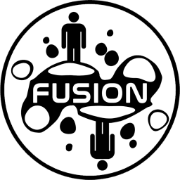

#  Fusion

**Fusion** is a [Geometry Dash](https://store.steampowered.com/app/322170/Geometry_Dash/) mod loader and modding SDK with a modern approach towards mod development. Unlike previous mod loaders, which merely inject the DLLs and let devs handle the rest, Geode aims to be a more comprehensive project, which manages loaded mods & hooks itself. Geode has been built to ensure performance, compatibility, portability and ease of use. For devs, Geode means easy development and portability; for end users, Geode means a uniform and easy experience using mods.
